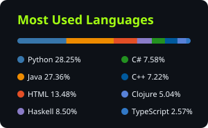

<h1> Hi, I'm Manoel Felipe! </h1>

<h3> I am a Computer Scientist who graduated at PUCPR and doing a Master's in Artificial Intelligence 👨‍💻 </h3>

#

<h2> Technologies I've Used </h2>

<h4> Languages </h4>

<h4> Frontend </h4>

<h4> Backend & Data </h4>

<h4> AI & Machine Learning </h4>

<h4> Tools & Deploy </h4>

